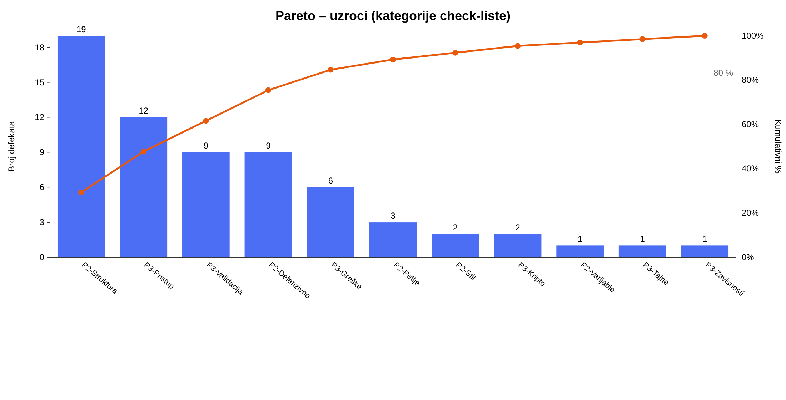
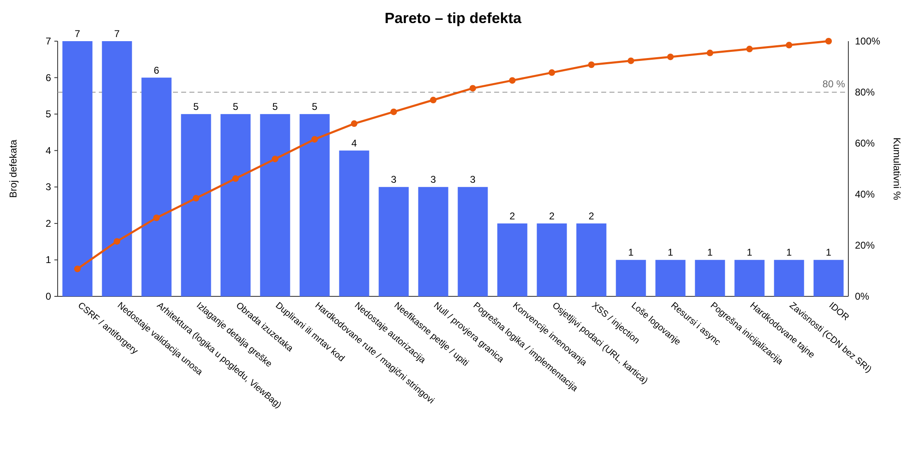
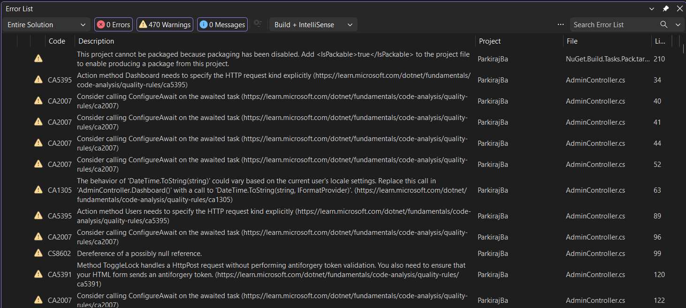

# Izvještaj – Projekat 1, Task 1: Inspekcija koda i statička analiza

**Predmet:** Verifikacija i validacija softvera (VVS)
**Pregledani kod:** ParkirajBa (ASP.NET Core MVC), Grupa4-Tim4
**Repozitorij:** github.com/VVS-2026-2027/Grupa4-Tim4, Pull Request #2 (`inspekcija` ← `main`)

---

## 1. Tim i organizacija

| Uloga | Član |
|---|---|
| Moderator | Anes Mirvić |
| Inspektori | Ajla, Nejla, Azra, Anes, Almedin |

**Postupak:**
1. Kod tima Grupa4-Tim4 postavljen je tako da PR `inspekcija` ← `main` prikazuje cijeli kod kao izmjenu. Tako se svaka linija može komentarisati.
2. Moderator je podijelio kod po funkcionalnim cjelinama i dodijelio check-liste.
3. Svaki inspektor je pregledao svoj dio u dva prolaza: (1) opšta check-lista (Predavanje 2), (2) sigurnosna check-lista (Predavanje 3).
4. Za svaki defekt ostavljen je komentar na liniju u PR-u (s ozbiljnošću i stavkom check-liste) i otvoren Issue s labelama `sev-1` … `sev-5` i `P2-*` / `P3-*`.
5. Moderator je provjerio sumnjive nalaze u kodu, spojio duplikate i izdvojio lažno pozitivne.

| Član | Dio koda |
|---|---|
| Ajla | Autentifikacija i korisnici (UserController, ApplicationUser, Views/User, Views/Admin/Korisnici), Shared layout (_Layout, _Header, _AdminSidebar, _AdminConfirmOverlay, Error) |
| Nejla | Plaćanje i QR (PaymentController, QrController, Views/Payment), servisi (EmailSender, ImageService, OverstayChargeService), Views/Reservation/Details |
| Azra | Rezervacije (ReservationController, Ticket, ReservationReminderService, Views/Reservation, Views/Home/Rezervacije, Admin/Rezervacije, Dashboard, Izvjestaji) |
| Anes | Parking objekti i mapa (ParkingController, HomeController, ParkingObject, Views/Home, Views/Parking, Admin/ParkingDetails) |
| Almedin | Baza i izvještaji (ApplicationDbContext, Migrations, Repositories, AdminController, ReportController, Views/Report, Admin/Parkinzi) |

**Trajanje inspekcije:** 12 h (priprema 3h, pregled 8h, sastanak 1h)

---

## 2. Korištene check-liste

### 2.1 Opšta check-lista (Predavanje 2, Wiegers)
| Šifra | Stavka |
|---|---|
| S1 | Da li kod u potpunosti i ispravno implementira zahtjev/dizajn? |
| S2 | Koriste li se imenovane konstante umjesto magičnih brojeva/stringova? |
| S3 | Ima li dupliciranog ili mrtvog koda? |
| S4 | Jesu li metode i klase razumne veličine (jedna odgovornost)? |
| V1 / V2 / V3 | Imenovanje; neinicijalizovane/nekorištene varijable; float poređenje, dijeljenje nulom |
| L1 / L2 / L3 | `default` u switch-u; uslovi i granice petlji; tačnost uslova u `if` |
| D1 / D2 / D3 | Null i granice; oslobađanje resursa i `await`; smislena obrada izuzetaka |
| K1 | C# konvencije imenovanja i komentari |

### 2.2 Sigurnosna check-lista (Predavanje 3)
| Šifra | Stavka |
|---|---|
| VAL1 / VAL2 | Validacija unosa; SQL injection / XSS |
| TAJ1 | Hardkodovane lozinke, ključevi, connection stringovi |
| PRI1 / PRI2 / PRI3 | `[Authorize]` i role; IDOR (vlasništvo resursa); CSRF (`[ValidateAntiForgeryToken]`) |
| KRI1 | Sigurno čuvanje i prijenos osjetljivih podataka |
| GRE1 / GRE2 | Stack trace / detalji greške korisniku; logovanje |
| ZAV1 | Zastarjeli ili ranjivi paketi i eksterne skripte |

---

## 3. Statistika

| Pokazatelj | Vrijednost |
|---|---|
| Ukupno prijavljenih nalaza (prije provjere) | 79 + 7 novih pri provjeri = 86 |
| Duplikati spojeni u jedan issue | 7 |
| Lažno pozitivni (nisu prijavljeni) | 10 |
| Slabi nalazi koje je moderator odbacio | 3 (23, 60/61, 62) |
| Nalaz zamijenjen drugim defektom | 1 (38 → N6) |
| **Potvrđeni defekti (issue-i)** | **65** |
| Broj linija koda (Analyze → Calculate Code Metrics) | ______ |
| Gustoća defekata | 65 / ______ LOC = ______ defekata na 1000 linija |

> Napomena: u trenutku pisanja izvještaja na GitHubu je otvoreno 39 issue-a; preostali se dodaju prema raspodjeli. Statistika ispod računa sve potvrđene defekte (65).

### 3.1 Po ozbiljnosti
| Ozbiljnost | Broj | % | Kumulativno |
|---|---|---|---|
| 2 – Nisko | 22 | 33.8 % | 33.8 % |
| 1 – Minorno | 17 | 26.2 % | 60.0 % |
| 3 – Srednje | 14 | 21.5 % | 81.5 % |
| 4 – Visoko | 9 | 13.8 % | 95.4 % |
| 5 – Kritično | 3 | 4.6 % | 100.0 % |

### 3.2 Po članu tima
| Član | Broj | % | Kumulativno |
|---|---|---|---|
| Anes | 20 | 30.8 % | 30.8 % |
| Nejla | 12 | 18.5 % | 49.2 % |
| Almedin | 11 | 16.9 % | 66.2 % |
| Ajla | 11 | 16.9 % | 83.1 % |
| Azra | 11 | 16.9 % | 100.0 % |

---

## 4. Najvažniji nalazi (ozbiljnost 4–5)

| # | Nalaz | Fajl | Ozbiljnost | Check-lista | Opis | Issue |
|---|---|---|---|---|---|---|
| 1 | 13 | `Controllers/QrController.cs` | 5 (Kritično) | P3-Pristup / PRI1 | api/qr/scan nema [Authorize], svako može lažirati ulaz/izlaz | #___ |
| 2 | 32 | `Services/EmailSender.cs` | 5 (Kritično) | P3-Tajne / TAJ1 | Hardkodovan Gmail nalog i app lozinka u kodu | #___ |
| 3 | N5 | `Controllers/PaymentController.cs` | 5 (Kritično) | P3-Pristup / PRI1 | SendConfirmationEmail označava tiket plaćenim bez provjere plaćanja | #___ |
| 4 | N1 | `Controllers/ParkingController.cs` | 4 (Visoko) | P3-Pristup / PRI2 | IDOR: Edit ne provjerava vlasnika parkinga | #___ |
| 5 | N4 | `Views/Home/Index.cshtml` | 4 (Visoko) | P3-Validacija / VAL2 | Stored XSS preko naziva parkinga u mapi i sidebaru | #___ |
| 6 | 1 | `Controllers/AdminController.cs` | 4 (Visoko) | P3-Pristup / PRI3 | Nema [ValidateAntiForgeryToken] na ToggleLock/ChangeRole/DeleteUser | #___ |
| 7 | 6 | `Controllers/HomeController.cs` | 4 (Visoko) | P3-Pristup / PRI1 | Javna testna akcija databaseTest upisuje podatke u bazu | #___ |
| 8 | 21 | `Repositories/ParkingRepository.cs` | 4 (Visoko) | P2-Defanzivno / D1 | GetMaxPricingForRegimeAsync: .price na null rezultatu | #___ |
| 9 | 33 | `Services/ImageService.cs` | 4 (Visoko) | P3-Validacija / VAL1 | SaveImageToServerAsync snima bilo koju ekstenziju u wwwroot | #___ |

**Ključno zapažanje:** plaćanje u aplikaciji je u potpunosti simulirano. Kartica se provjerava samo na klijentu (Luhn), a `SendConfirmationEmail` označava tiket plaćenim bez ikakve serverske provjere i bez CSRF zaštite. Zajedno s otvorenim `api/qr/scan` endpointom (13) i testnim skenerom u pogledu (66), korisnik može zaobići i plaćanje i ulaz na parking.

---

## 5. Pareto analiza

### 5.1 Pareto po uzrocima (kategorije check-liste)
| Kategorija (check-lista) | Broj | % | Kumulativno |
|---|---|---|---|
| P2-Struktura | 19 | 29.2 % | 29.2 % |
| P3-Pristup | 12 | 18.5 % | 47.7 % |
| P3-Validacija | 9 | 13.8 % | 61.5 % |
| P2-Defanzivno | 9 | 13.8 % | 75.4 % |
| P3-Greške | 6 | 9.2 % | 84.6 % |
| P2-Petlje | 3 | 4.6 % | 89.2 % |
| P2-Stil | 2 | 3.1 % | 92.3 % |
| P3-Kripto | 2 | 3.1 % | 95.4 % |
| P2-Varijable | 1 | 1.5 % | 96.9 % |
| P3-Tajne | 1 | 1.5 % | 98.5 % |
| P3-Zavisnosti | 1 | 1.5 % | 100.0 % |

**Tumačenje:** pet kategorija (P2-Struktura, P3-Pristup, P3-Validacija, P2-Defanzivno i P3-Greške) čini oko **85 %** svih defekata. Najviše defekata je u strukturi koda (logika u pogledima, hardkodovane rute, duplirani kod), ali su najteži defekti u kontroli pristupa i validaciji unosa. Tim bi prvo trebao popraviti **P3-Pristup** (autorizacija, IDOR, CSRF), jer sadrži 2 od 3 kritična defekta.

### 5.2 Pareto po tipu defekta
| Tip defekta | Broj | % | Kumulativno |
|---|---|---|---|
| CSRF / antiforgery | 7 | 10.8 % | 10.8 % |
| Nedostaje validacija unosa | 7 | 10.8 % | 21.5 % |
| Arhitektura (logika u pogledu, ViewBag) | 6 | 9.2 % | 30.8 % |
| Izlaganje detalja greške | 5 | 7.7 % | 38.5 % |
| Obrada izuzetaka | 5 | 7.7 % | 46.2 % |
| Duplirani ili mrtav kod | 5 | 7.7 % | 53.8 % |
| Hardkodovane rute / magični stringovi | 5 | 7.7 % | 61.5 % |
| Nedostaje autorizacija | 4 | 6.2 % | 67.7 % |
| Neefikasne petlje / upiti | 3 | 4.6 % | 72.3 % |
| Null / provjera granica | 3 | 4.6 % | 76.9 % |
| Pogrešna logika / implementacija | 3 | 4.6 % | 81.5 % |
| Konvencije imenovanja | 2 | 3.1 % | 84.6 % |
| Osjetljivi podaci (URL, kartica) | 2 | 3.1 % | 87.7 % |
| XSS / injection | 2 | 3.1 % | 90.8 % |
| Loše logovanje | 1 | 1.5 % | 92.3 % |
| Resursi i async | 1 | 1.5 % | 93.8 % |
| Pogrešna inicijalizacija | 1 | 1.5 % | 95.4 % |
| Hardkodovane tajne | 1 | 1.5 % | 96.9 % |
| Zavisnosti (CDN bez SRI) | 1 | 1.5 % | 98.5 % |
| IDOR | 1 | 1.5 % | 100.0 % |

**Tumačenje:** prvih 11 tipova (CSRF, validacija unosa, arhitektura pogleda, izlaganje grešaka, obrada izuzetaka, mrtav kod, hardkodovane rute, autorizacija, petlje, null provjere, logika) čini oko **80 %** defekata. CSRF i validacija unosa su na vrhu, a oba se mogu riješiti centralno: globalni `AutoValidateAntiforgeryTokenAttribute` i zajednička validacija uploada.

---

## 6. Lažno pozitivni nalazi

Moderator je provjerio sumnjive nalaze direktno u kodu. Sljedeći nalazi nisu prijavljeni kao defekti:

| Nalaz | Obrazloženje |
|---|---|
| 31 | CardPaymentViewModel: Checkout.cshtml ne šalje broj kartice ni CVV na server (inputi bez name, samo JS provjera); model se ne koristi za prijenos podataka kartice. |
| 39 | Parkinzi.cshtml: forma koristi asp-action, pa Form Tag Helper automatski dodaje __RequestVerificationToken. |
| 41 | Admin/Rezervacije.cshtml: forma koristi asp-action, token se dodaje automatski. |
| 48 | Export Excel/PDF preko GET linka je standardna praksa i ne mijenja stanje aplikacije. |
| 50 | _ParkingCreate / ParkingManagement: token se šalje u HTTP zaglavlju RequestVerificationToken (ParkingManagement.cshtml, linija 652). |
| 55 | ParkingManagement: loadForm zamjenjuje HTML forme preko innerHTML (linija 291), a initPricingLogic koristi cloneNode (linija 414); listeneri se ne dupliraju. |
| 68 | Extend.cshtml: forma s asp-controller/asp-action automatski dobija token. |
| 77 | Profile.cshtml: forma method="post" bez action atributa automatski dobija token. |
| 78 | Register.cshtml: asp-for="Ime" generiše id="Ime", pa getElementById pronalazi element. |
| 79 | Register.cshtml: forma s asp-controller/asp-action automatski dobija token. |

**Nalaz 38 zamijenjen stvarnim defektom:** opis (decimalni zarez) nije tačan, jer JS već radi `replace(',', '.')`. Pri provjeri istog bloka nađen je drugi defekt: skrivena polja cijena se dodaju i pri neuspješnoj validaciji, pa se pri ponovnom slanju dupliraju (N6).

**Korigovane ozbiljnosti nakon provjere koda:** 53 (2 → 1, koristi se samo vrijeme), 54 (server za grešku vraća status 200 i `success:false`, pa korisnik uvijek vidi poruku o uspjehu), 56 (4 → 2, kroz URL ide samo ime na kartici, ne broj kartice ni CVV).

**Novi defekti nađeni pri provjeri:** N1 IDOR u `ParkingController.Edit`, N2 `ex.Message` u odgovoru `Create`, N3 mrtav kod, N4 stored XSS u `Index.cshtml`, N5 plaćanje bez provjere, N6 duplirana polja cijena, N7 suvišan regex na `int` svojstvima.

---

## 7. Statička analiza (Task 1.2)

### Alat i podešavanje
- **Alat:** ugrađeni Roslyn .NET analizatori u Visual Studiju (pravila CA = kvalitet i sigurnost koda, CS = upozorenja kompajlera).
- **Podešavanje:** u `ParkirajBa.csproj` dodano `<EnableNETAnalyzers>true</EnableNETAnalyzers>`, `<AnalysisMode>All</AnalysisMode>` i `<EnforceCodeStyleInBuild>true</EnforceCodeStyleInBuild>`. `AnalysisMode = All` uključuje sva pravila, i ona koja su po defaultu isključena.
- **Pokretanje:** Build → Rebuild Solution, rezultati u View → Error List (Build + IntelliSense, Errors + Warnings + Messages).
- Izmjena u `.csproj` je napravljena samo lokalno za analizu i nije commitovana u kod tima čiji kod pregledamo.

### Rezultati – ukupno
**Rezultat builda: 0 Errors, 470 Warnings, 0 Messages** (kod se kompajlira; svi nalazi su upozorenja).

| Kategorija | Broj | % |
|---|---|---|
| CA (kvalitet koda, pouzdanost, sigurnost) | 416 | 88,5 % |
| CS (kompajler, nullable upozorenja) | 53 | 11,3 % |
| NETSDK / ostalo (IsPackable) | 1 | 0,2 % |

### CA pravila po broju (Pareto)
| Pravilo | Opis | Broj | Kumulativno |
|---|---|---|---|
| CA2007 | Pozvati `ConfigureAwait` na awaited tasku | 246 | 59 % |
| CA5395 | Akcija ne navodi eksplicitno HTTP metodu (`[HttpGet]`) | 34 | 67 % |
| CA1062 | Validacija argumenata javnih metoda (null) | 28 | 74 % |
| CA1305 | `ToString`/`Parse` bez `IFormatProvider` (kultura) | 26 | 80 % |
| CA5391 | **POST akcija bez provjere antiforgery tokena (CSRF)** | 17 | 84 % |
| CA1002 | Javno izlaganje `List<T>` umjesto kolekcijskog interfejsa | 13 | 87 % |
| CA1031 | `catch (Exception)` – hvatanje preopćenitog izuzetka | 10 | 89 % |
| CA1805 | Eksplicitna inicijalizacija na default vrijednost | 7 | 91 % |
| CA1848 | Logovanje bez `LoggerMessage` delegata (performanse) | 6 | 92 % |
| CA1861 | Konstantni nizovi kao argumenti | 5 | 94 % |
| CA2000 | **Objekat se ne dispose-uje (`MailMessage`, `SmtpClient`)** | 4 | 95 % |
| CA1307 / CA1304 / CA1311 | Poređenje/konverzija stringova bez kulture | 10 | 97 % |
| CA1849 | **Sinhroni poziv u async metodi (`SaveChanges`, `Run`)** | 2 | 98 % |
| CA2227, CA1822, CA1725, CA1052, CA2201, CA2254 | Ostalo | 8 | 100 % |

### CS (kompajler) upozorenja
| Pravilo | Opis | Broj |
|---|---|---|
| CS8618 | Non-nullable svojstvo nije inicijalizovano u konstruktoru | 33 |
| CS8602 | Dereferenciranje moguće null reference | 8 |
| CS8600 / CS8601 / CS8604 / CS8603 / CS8629 / CS8619 | Ostala nullable upozorenja | 12 |

### Top 5 pravila i tumačenje
1. **CA2007 (246)** – u ASP.NET Core aplikaciji nema `SynchronizationContext`, pa `ConfigureAwait(false)` ne mijenja ponašanje. Pravilo je namijenjeno bibliotekama. **Lažno pozitivno / šum** za ovaj tip projekta.
2. **CA5395 (34)** – GET akcije bez `[HttpGet]`. Djelimično opravdano: akcija bez atributa prihvata i POST, pa je tada i CSRF moguć. Za obične GET stranice (Index, Details) uglavnom šum.
3. **CA1062 (28)** – projekat ima uključen nullable, pa je pravilo uglavnom redundantno, ali ukazuje na metode koje ne provjeravaju argumente.
4. **CA1305 (26)** – formatiranje datuma i brojeva bez kulture. **Stvarni rizik** u ovoj aplikaciji: decimale i datumi se prenose između JS-a i servera (vidi ručne nalaze 38, 53).
5. **CA5391 (17)** – **najvažniji sigurnosni nalaz alata**. 17 POST akcija bez provjere antiforgery tokena: ToggleLock, ChangeRole, DeleteUser, DeleteParking, DeleteReservation, UploadParkingImage, Create (×2), Edit, UploadCoverImage, Cancel, Extend, Login, Register, Profile, PosaljiEmail, SendConfirmationEmail.

### Primjeri
- **CA5391** – `AdminController.DeleteUser` (POST) nema `[ValidateAntiForgeryToken]`. Potvrđuje ručne nalaze 1, 8 i 15 i dokazuje da u projektu ne postoji globalni `AutoValidateAntiforgeryToken` filter.
- **CA2000** – `new MailMessage` i `new SmtpClient("smtp.gmail.com")` se ne dispose-uju (EmailSender). Ovo **ručna inspekcija nije našla** (P2 check-lista D2).
- **CA1849** – `DbContext.SaveChanges()` sinhrono blokira. Isto kao ručni nalaz 19 (ParkingRepository.ModifyParkingAsync).
- **CA1031** – `catch (Exception)` u PosaljiEmail, SendConfirmationEmail, Cancel, Create, Edit, ExecuteAsync, SendEmailAsync. Poklapa se s ručnim nalazima 5, 11, 16 i 35.
- **CS8618 / CS8602** – npr. `ParkingObject.name`, `address` i `Owner` su non-nullable, a nisu inicijalizovani. Povezano s ručnim nalazom 21 i stavkom D1 (null provjere).

### Lažno pozitivni nalazi alata
- **CA2007 (246)** – nema efekta u ASP.NET Core (nema SynchronizationContext).
- **CA5395** na običnim GET stranicama – akcije samo prikazuju podatke.
- **CA1062** u projektu s uključenim nullable tipovima – kompajler već pokriva veći dio.
- **CA1052** (`Program` nije static) – standardni šablon ASP.NET Core aplikacije.
- **IsPackable** poruka – web aplikacija se ne pakuje kao NuGet paket.

Bez CA2007 ostaje **224** poruke, a od toga je oko 60 stvarno korisno (CA5391, CA1031, CA2000, CA1849, CA1305, nullable upozorenja).

### Poređenje s ručnom inspekcijom
| | Alat našao | Alat NIJE našao |
|---|---|---|
| **Ručna inspekcija našla** | CSRF na POST akcijama (1, 8, 15 → CA5391), sinhroni SaveChanges (19 → CA1849), preopćeniti catch (5, 11, 16, 35 → CA1031), null rizici (21 → CS8602) | Hardkodovana lozinka (32), QR endpoint bez `[Authorize]` (13), IDOR u ParkingController.Edit, path traversal (2, 10), upload bez validacije (4, 33), stored XSS u JS-u (Index.cshtml), plaćanje bez provjere, poslovna logika (30, 54), sve greške u Razor/JS pogledima |
| **Ručna inspekcija NIJE našla** | Nedispose-ovani `MailMessage`/`SmtpClient` (CA2000), formatiranje bez kulture na 26 mjesta (CA1305), 33 neinicijalizovana non-nullable svojstva (CS8618), akcije bez eksplicitne HTTP metode (CA5395) | – |

**Zaključak:** alat je brz i dobar za mehanička pravila (CSRF atribut, dispose, async, null, kultura), ali proizvodi mnogo šuma (CA2007 je 52 % svih poruka). Ne vidi poslovnu logiku, kontrolu pristupa po vlasniku (IDOR), tajne u kodu, ni kod u `.cshtml`/JavaScript dijelu. Najteže greške (sev 4–5) pronašla je ručna inspekcija, pa se alat i ručna inspekcija dopunjuju.

---

## 8. Zaključak

Ručnom inspekcijom potvrđeno je **65 defekata**, od toga **3 kritična** i **9 visoke ozbiljnosti**. Najteži problemi su u kontroli pristupa (otvoreni QR endpoint, plaćanje bez provjere, IDOR, CSRF na 17 POST akcija) i rukovanju tajnama (lozinka u izvornom kodu). Statička analiza je potvrdila CSRF i dio problema s izuzecima i async kodom, i dodala nalaz o nedispose-ovanim objektima. Najteže defekte, međutim, nije prepoznala, jer zahtijevaju razumijevanje poslovne logike, Razor pogleda i JavaScript koda. Provjera nalaza u kodu je otkrila 10 lažno pozitivnih nalaza i 7 novih defekata, što pokazuje vrijednost uloge moderatora i drugog prolaza kroz kod.

**Preporuka (redoslijed popravki):**
1. Ukloniti lozinku iz koda i opozvati je (32).
2. Zaštititi `api/qr/scan` i ukloniti testni skener (13, 66).
3. Uvesti stvarnu provjeru plaćanja (N5).
4. Uvesti globalnu CSRF zaštitu (1, 8, 15, 18).
5. Provjera vlasništva u Edit (N1) i escapovanje u JS-u (N4).
6. Validacija uploada (4, 33) i path traversal (2, 10).