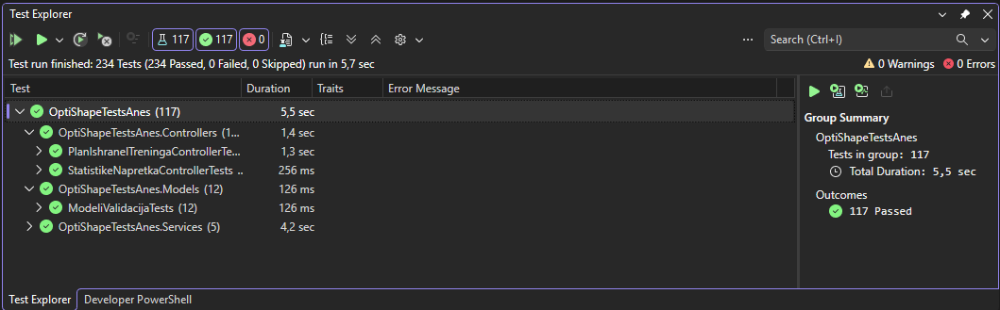
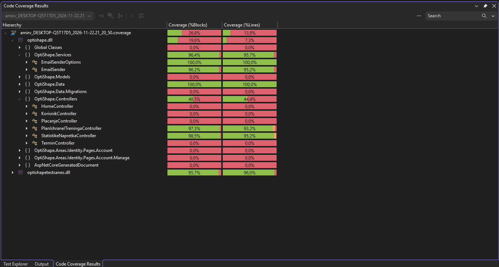

# Task 2 – Unit testiranje: dio Anes Mirvić
 
**Testni projekat:** `OptiShapeTestsAnes` (MSTest, .NET 8)
**Testirane klase:** `PlanIshraneITreningaController`, `StatistikeNapretkaController`, `EmailSender` (+ `EmailSenderOptions`), modeli `StatistikeNapretka` i `PlanIshraneTreninga`
**Alati:** MSTest, Moq (zamjenski objekti), EF Core InMemory (zamjena za bazu), Visual Studio Code Coverage
**Rezultat:** 70 testnih metoda, odnosno **117 testnih slučajeva** (sa DataRow/DynamicData varijantama), **svi prolaze**.
 

 
---
 
## 1. Organizacija testova
 
| Folder / fajl | Šta sadrži |
|---|---|
| `Helpers/TestHelper.cs` | Zajednički kod: nova InMemory baza za svaki test, testni korisnici (2 trenera, 3 korisnika), prijava korisnika sa ulogom (`ClaimsPrincipal`), mock `UserManager`-a |
| `Controllers/PlanIshraneITreningaControllerTests.cs` | Testovi za kontroler planova ishrane i treninga |
| `Controllers/StatistikeNapretkaControllerTests.cs` | Testovi za kontroler statistika napretka (uključujući data-driven iz CSV i JSON) |
| `Services/EmailSenderTests.cs` | Testovi za servis za slanje emaila (Moq) |
| `Models/ModeliValidacijaTests.cs` | Testovi validacije modela (granične vrijednosti) |
| `TestData/bmi_podaci.csv`, `TestData/statistike_korisnika.json` | Podaci za data-driven testove |
 
**Principi koji su poštovani:**
- **Imenovanje** `Metoda_Scenarij_OcekivaniRezultat` (npr. `Details_TrenerTudjegKorisnika_VracaForbid`).
- **AAA struktura** (Arrange – Act – Assert) u svakom testu.
- **Bez programske logike** u testovima (nema `if`, petlji ni `try/catch`). Različiti slučajevi se pokrivaju kroz `DataRow` i `DynamicData`.
- **Međusobna neovisnost**: `[TestInitialize]` za svaki test pravi **novu, praznu InMemory bazu** (jedinstveno ime baze preko `Guid`) i novi kontroler, a `[TestCleanup]` ih oslobađa. Testovi se zato mogu izvršavati paralelno i bilo kojim redoslijedom.
- Testirani su **uspješni slučajevi, neuspješni slučajevi** (NotFound, Forbid, Unauthorized, nevalidan model) i **izuzeci**.
**Korišteni stereotipi (atributi) za testne metode:**
 
| Atribut | Gdje je korišten |
|---|---|
| `[TestClass]`, `[TestMethod]` | Sve testne klase i metode |
| `[TestInitialize]`, `[TestCleanup]` | Priprema i čišćenje baze i kontrolera prije/poslije svakog testa |
| `[ClassInitialize]`, `[ClassCleanup]` | `PlanIshraneITreningaControllerTests`: postavljanje i brisanje zajedničkog datuma plana |
| `[DataRow]` | Testovi po ulogama (Administrator/Trener/Korisnik), granične vrijednosti validacije |
| `[DynamicData]` | Data-driven testovi iz CSV i JSON fajla |
| `[TestCategory]` | Grupisanje: `PlanIshraneITreninga`, `StatistikeNapretka`, `EmailSender`, `Modeli`, `DataDriven`, `Mock`, `Izuzeci`, `PronadjenaGreska` |
| `[TestProperty]` | Izvor podataka za data-driven testove (`Izvor = CSV` / `Izvor = JSON`) |
| `[Priority]` | Najvažniji testovi (osnovni CRUD tokovi) označeni sa `Priority(1)` |
| `[Timeout]` | Testovi koji pristupaju bazi kod konkurentne izmjene i SMTP konekciji (5 s, odnosno 15 s) |
 
Izuzeci se provjeravaju preko `Assert.ThrowsExactlyAsync<T>(...)`.
 
---
 
## 2. Spisak testova
 
### 2.1 `PlanIshraneITreningaControllerTests` (30 metoda)
 
| # | Test | Slučajeva |
|---|---|---|
| 1 | `Index_PoUlogama_VracaOdgovarajuciViewIBrojPlanova` | 3 |
| 2 | `Index_KorisnikNijeUBaziIliNemaUlogu_VracaUnauthorized` | 3 |
| 3 | `Details_IdNull_VracaNotFound` | 1 |
| 4 | `Details_NepostojeciPlan_VracaNotFound` | 1 |
| 5 | `Details_AdminPostojeciPlan_VracaViewSaPlanom` | 1 |
| 6 | `Details_TrenerSvogKorisnika_VracaView` | 1 |
| 7 | `Details_TrenerTudjegKorisnikaIliNepostojeciTrener_VracaForbid` | 2 |
| 8 | `Create_Get_PunPadajuciMeniPremaUlozi` | 3 |
| 9 | `Create_ValidanPlan_SnimaPlanIPreusmjerava` | 1 |
| 10 | `Create_NevalidanModel_VracaFormuSaPadajucimMenijem` | 3 |
| 11 | `Edit_Get_IdNull_VracaNotFound` | 1 |
| 12 | `Edit_Get_NepostojeciPlan_VracaNotFound` | 1 |
| 13 | `Edit_Get_Admin_VracaViewSaSvimKorisnicima` | 1 |
| 14 | `Edit_Get_TrenerSvogKorisnika_VracaViewSaSvojimKorisnicima` | 1 |
| 15 | `Edit_Get_TrenerTudjegKorisnika_VracaForbid` | 2 |
| 16 | `Edit_Post_IdSeNePoklapa_VracaNotFound` | 1 |
| 17 | `Edit_Post_ValidanPlan_AzuriraKalorijeIPreusmjerava` | 1 |
| 18 | `Edit_Post_PlanObrisanUMedjuvremenu_VracaNotFound` | 1 |
| 19 | `Edit_Post_NevalidanModelAdmin_VracaFormu` | 1 |
| 20 | `Edit_Post_NevalidanModelTrenerSvogKorisnika_VracaFormuSaSvojimKorisnicima` | 1 |
| 21 | `Edit_Post_NevalidanModelTrenerTudjegKorisnika_VracaForbid` | 1 |
| 22 | `Delete_Get_Trener_VracaForbid` | 1 |
| 23 | `Delete_Get_IdNullIliNepostojeci_VracaNotFound` | 2 |
| 24 | `Delete_Get_PostojeciPlan_VracaViewZaPotvrdu` | 1 |
| 25 | `DeleteConfirmed_Trener_VracaForbidINeBrise` | 1 |
| 26 | `DeleteConfirmed_PostojeciPlan_BrisePlanIPostavljaPoruku` | 1 |
| 27 | `DeleteConfirmed_NepostojeciPlan_PreusmjeravaBezBrisanja` | 1 |
| 28 | `PieChart_NepostojeciPlan_VracaNotFound` | 1 |
| 29 | `PieChart_DozvoljenPristup_VracaViewSaPlanom` | 3 |
| 30 | `PieChart_TudjiPlan_VracaForbid` | 2 |
 
### 2.2 `StatistikeNapretkaControllerTests` (30 metoda)
 
| # | Test | Slučajeva |
|---|---|---|
| 1 | `Index_Administrator_KorisnikaCitaIzClaimovaANeIzUserManagera` (mock) | 1 |
| 2 | `Index_PoUlogama_VracaOdgovarajuciBrojStatistika` | 3 |
| 3 | `Index_TrenerNijeUBazi_VracaUnauthorized` | 1 |
| 4 | `Index_KorisnikNijeUBazi_VracaNotFoundSaPorukom` | 1 |
| 5 | `Details_IdNullIliNepostojeci_VracaNotFound` | 2 |
| 6 | `Details_DozvoljenPristup_VracaViewSaStatistikom` | 3 |
| 7 | `Details_TudjaStatistika_VracaForbid` | 4 |
| 8 | `Create_Get_PunPadajuciMeniSaSvimKorisnicima` | 1 |
| 9 | `Create_PodaciIzCsv_RacunaBmiPremaVisiniKorisnika` (**data-driven, CSV**) | 5 |
| 10 | `Create_ValidnaStatistika_SnimaIPreusmjerava` | 1 |
| 11 | `Create_NepostojeciKorisnikIliNevalidnaVisina_VracaFormuSaGreskom` | 2 |
| 12 | `Edit_Get_IdNullIliNepostojeci_VracaNotFound` | 2 |
| 13 | `Edit_Get_DozvoljenPristup_VracaViewSaPadajucimMenijem` | 2 |
| 14 | `Edit_Get_TrenerTudjegKorisnika_VracaForbid` | 2 |
| 15 | `Edit_Post_IdSeNePoklapa_VracaNotFound` | 1 |
| 16 | `Edit_Post_ValidnaIzmjena_PreracunavaBmiIPreusmjerava` | 2 |
| 17 | `Edit_Post_TrenerTudjegKorisnika_VracaForbid` | 2 |
| 18 | `Edit_Post_NepostojeciKorisnikIliNevalidnaVisina_VracaFormuSaGreskom` | 2 |
| 19 | `Edit_Post_StatistikaObrisanaUMedjuvremenu_VracaNotFound` | 1 |
| 20 | `Delete_Get_IdNullIliNepostojeci_VracaNotFound` | 2 |
| 21 | `Delete_Get_PostojecaStatistika_VracaViewZaPotvrdu` | 1 |
| 22 | `DeleteConfirmed_PostojecaStatistika_BriseIPostavljaPoruku` | 1 |
| 23 | `DeleteConfirmed_NepostojecaStatistika_PreusmjeravaBezBrisanja` | 1 |
| 24 | `CreateForUser_Get_VracaFormuSaDanasnjimDatumom` | 1 |
| 25 | `CreateForUser_PodaciIzJson_RacunaBmiIKalorijskiUnos` (**data-driven, JSON**) | 4 |
| 26 | `CreateForUser_KorisnikNijeUBazi_VracaNotFound` | 1 |
| 27 | `CreateForUser_KorisnikBezVisine_VracaFormuSaGreskom` | 1 |
| 28 | `CreateForUser_NevalidanModel_VracaFormuBezSnimanja` | 1 |
| 29 | `Graf_PoUlogama_VracaStatistikeSortiranePoDatumu` | 3 |
| 30 | `Graf_PrijavljeniNijeUBazi_BacaInvalidOperationException` (izuzetak) | 2 |
 
### 2.3 `EmailSenderTests` (5 metoda)
 
| # | Test | Slučajeva |
|---|---|---|
| 1 | `Konstruktor_MockOpcije_CitaVrijednostTacnoJednom` (mock) | 1 |
| 2 | `EmailSenderOptions_NoviObjekat_ImaGmailPodrazumijevaneVrijednosti` | 1 |
| 3 | `SendEmailAsync_NevalidnaAdresaPrimaoca_BacaFormatException` (izuzetak, mock) | 1 |
| 4 | `SendEmailAsync_PosiljalacNijePodesen_BacaArgumentNullException` (izuzetak) | 1 |
| 5 | `SendEmailAsync_SmtpServerNedostupan_BacaSmtpException` (izuzetak) | 1 |
 
### 2.4 `ModeliValidacijaTests` (5 metoda)
 
| # | Test | Slučajeva |
|---|---|---|
| 1 | `StatistikeNapretka_GranicneVrijednostiTezineIBmi_IspravnaValidacija` | 7 |
| 2 | `StatistikeNapretka_TezinaMaloIzvanOpsega_ProlaziZbogCjelobrojnihGranica` | 2 |
| 3 | `StatistikeNapretka_TezinaIzvanOpsega_VracaPorukuOGresci` | 1 |
| 4 | `StatistikeNapretka_PostavljenKorisnik_CuvaVezuNaKorisnika` | 1 |
| 5 | `PlanIshraneTreninga_SvaPoljaPopunjena_JeValidan` | 1 |
 
**Ukupno: 70 testnih metoda, 117 testnih slučajeva.**
 
---
 
## 3. Data-driven testiranje
 
Podaci su odvojeni od logike testa i pohranjeni u fajlove u folderu `TestData` (svojstvo *Copy to Output Directory = Copy if newer*). Podaci se učitavaju kroz statička svojstva i proslijeđuju testu atributom `[DynamicData]`. Korištene su **dvije forme pohranjenih podataka: CSV i JSON**.
 
### 3.1 CSV – izračun BMI pri kreiranju statistike (administrator)
 
**Testirana funkcionalnost:** `StatistikeNapretkaController.Create` (POST) uzima visinu odabranog korisnika iz baze i računa BMI po formuli
`BMI = težina / (visina u metrima)²`, zaokruženo na 2 decimale.
 
**Test:** `Create_PodaciIzCsv_RacunaBmiPremaVisiniKorisnika`
 
**Fajl `TestData/bmi_podaci.csv`:**
```
tezina,visinaKorisnika,ocekivaniBmi
80,180,24.69
60,165,22.04
100,190,27.7
45,150,20
120,175,39.18
```
Svaki red je jedan testni slučaj (5 slučajeva). Test za svaki red doda korisnika sa zadanom visinom, pozove `Create` i provjeri izračunati BMI (`Assert.AreEqual` sa tolerancijom 0,001). Brojevi se parsiraju sa `CultureInfo.InvariantCulture`, da test radi isto bez obzira na regionalne postavke računara (decimalna tačka ili zarez).
 
### 3.2 JSON – BMI i kalorijski unos kada korisnik sam unosi statistiku
 
**Testirana funkcionalnost:** `StatistikeNapretkaController.CreateForUser` (POST) za prijavljenog korisnika:
- pronalazi korisnika po emailu iz prijave,
- računa BMI iz njegove visine,
- računa kalorijski unos `round(24 × težina × 1,2)`,
- veže statistiku za tog korisnika.
**Test:** `CreateForUser_PodaciIzJson_RacunaBmiIKalorijskiUnos`
 
**Fajl `TestData/statistike_korisnika.json`:**
```json
[
  { "Tezina": 80,   "Visina": 180, "OcekivaniBmi": 24.69, "OcekivaniKalorijskiUnos": 2304 },
  { "Tezina": 60,   "Visina": 165, "OcekivaniBmi": 22.04, "OcekivaniKalorijskiUnos": 1728 },
  { "Tezina": 72.5, "Visina": 170, "OcekivaniBmi": 25.09, "OcekivaniKalorijskiUnos": 2088 },
  { "Tezina": 95,   "Visina": 200, "OcekivaniBmi": 23.75, "OcekivaniKalorijskiUnos": 2736 }
]
```
JSON se deserijalizuje u `record StatistikaSlucaj` (`System.Text.Json`). Test provjerava 4 stvari: preusmjeravanje nakon snimanja, BMI, kalorijski unos i da je statistika vezana za prijavljenog korisnika.
 
### 3.3 Inline parametrizovani testovi (`DataRow`)
Pored testova iz fajlova, `[DataRow]` je korišten za:
- ponašanje akcija **po ulogama** (Administrator, Trener, Korisnik, korisnik bez uloge),
- **granične vrijednosti** validacije modela `StatistikeNapretka` (težina 30/200 i 29/201, BMI 0/100 i −1/101).
---
 
## 4. Zamjenski objekti (test doubles)
 
| Zamjenski objekat | Vrsta | Gdje i zašto |
|---|---|---|
| `Mock<IOptions<EmailSenderOptions>>` (Moq) | **Mock** | `EmailSenderTests`: konfiguracija SMTP-a se ne čita iz `appsettings.json`, nego je zadaje mock (`Setup(o => o.Value).Returns(opcije)`). Test `Konstruktor_MockOpcije_CitaVrijednostTacnoJednom` sa `Verify(o => o.Value, Times.Once)` provjerava da servis opcije pročita **tačno jednom**, u konstruktoru. SMTP server je podešen na `localhost:1`, pa se nijedan pravi email ne šalje. |
| `Mock<UserManager<ApplicationUser>>` (Moq) | **Mock** | `StatistikeNapretkaControllerTests`: kontroler u konstruktoru traži `UserManager`, koji bez baze i Identity servisa ne može postojati, pa se zamjenjuje mockom. Test `Index_Administrator_KorisnikaCitaIzClaimovaANeIzUserManagera` sa `Verify(..., Times.Never)` dokazuje da kontroler prijavljenog korisnika čita iz claimova, a ne preko `UserManager`-a. |
| EF Core **InMemory** baza | **Fake** | Svi testovi kontrolera: umjesto SQL Server baze koristi se baza u memoriji, kako postavka i dozvoljava („baza ne treba biti aktivna"). Svaki test dobija novu bazu sa poznatim podacima (`TestHelper.DodajKorisnike`). |
| `ClaimsPrincipal` + `DefaultHttpContext` | **Stub** | `TestHelper.PrijaviKorisnika`: simulira prijavljenog korisnika sa emailom i ulogom, bez pravog logina. |
| `Mock.Of<ITempDataProvider>()` | **Stub** | Omogućava kontroleru da postavlja `TempData` poruke (npr. „Plan je uspješno dodat.") koje test zatim provjerava. |
 
---
 
## 5. Pokrivenost koda
 
Pokrivenost je izmjerena alatom **Visual Studio → Test → Analyze Code Coverage for All Tests**.
 

 
| Klasa | Pokrivenost blokova | Pokrivenost linija |
|---|---|---|
| `PlanIshraneITreningaController` | **97,3 %** | **93,2 %** |
| `StatistikeNapretkaController` | **98,5 %** | **95,2 %** |
| `EmailSender` | **96,2 %** | **95,2 %** |
| `EmailSenderOptions` | **100 %** | **100 %** |
| `StatistikeNapretka`, `PlanIshraneTreninga` (modeli) | 100 %* | 100 %* |
 
\* Modeli sadrže samo auto-svojstva (`{ get; set; }`) koja Visual Studio alat ne prikazuje u izvještaju (generisani kod). Sva svojstva se koriste u testovima (coverlet ih mjeri sa 100 %).
 
**Nepokrivene linije i zašto:**
- `PlanIshraneITreningaController.Edit` (GET i POST): `else` grana kada trener nije pronađen u drugom bloku za padajući meni. **Nedostižna je**, jer isti slučaj ranije u metodi već vrati `Forbid()`.
- `throw;` u `catch (DbUpdateConcurrencyException)` (Edit u oba kontrolera): izvršava se samo kada zapis postoji, a ipak dođe do konkurentne izmjene, što se u InMemory bazi ne može izazvati. Grana kada zapis **ne postoji** (`NotFound`) jeste pokrivena.
- `EmailSender.SendEmailAsync`: zatvarajuća zagrada nakon `await client.SendMailAsync(...)` se ne broji jer test namjerno dobija `SmtpException` (bez slanja pravog emaila).
---
 
## 6. Greške pronađene testiranjem
 
1. **`[Range(30, 200)]` na `StatistikeNapretka.Tezina` je zadan cijelim brojevima.** Svojstvo je `double`, pa se vrijednost prije poređenja zaokružuje na `int`. Zato **29,9 kg i 200,4 kg prolaze validaciju**. Test `StatistikeNapretka_TezinaMaloIzvanOpsega_ProlaziZbogCjelobrojnihGranica` (kategorija `PronadjenaGreska`) dokumentuje ovo ponašanje. Ispravka: `[Range(30.0, 200.0)]`. Isto važi i za `[Range(0, 100)]` na BMI, a poruka za BMI („između 10 i 60") se ne poklapa sa stvarnim opsegom (0–100).
2. **`StatistikeNapretkaController.Graf` baca izuzetak** (`InvalidOperationException` s unutrašnjim `NullReferenceException`) kada prijavljeni trener ili korisnik ne postoji u tabeli `Korisnik`, jer se `trener.IdKorisnika` / `korisnik.IdKorisnika` koristi bez provjere na `null`. Test `Graf_PrijavljeniNijeUBazi_BacaInvalidOperationException` to pokazuje. Ispravka: provjera `if (trener == null) return Unauthorized();`, kao u akciji `Index`.
3. `Graf` ima `[Authorize(Roles = "Korisnik")]`, a unutra grane za Administratora i Trenera. Te grane su nedostižne kroz web (atribut ih blokira), iako ih unit test može pozvati direktno.
 